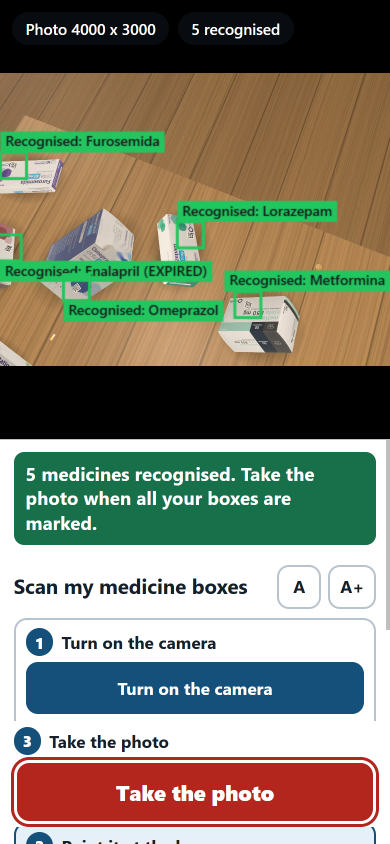

# med-table (hackathon prototype)

A tool for caregivers of older adults on many medicines. Photograph the packs on the table; the system identifies each pack from its official code, checks it against Spain's AEMPS/CIMA database, and builds a verified inventory. The caregiver sets the schedule (from the active medication sheet), and the tool produces a printable pictogram calendar, a voice reading and a calendar file for phone reminders.

**What it is not.** It does not give medical advice, does not decide doses, and is not a medical device. The schedule always comes from the prescription, entered or confirmed line by line by the caregiver. Every flag shown cites an AEMPS source, with the quoted sentence checked against the original text; the section 4.5 excerpts are shown for the pharmacist to review, never as a verdict. When it cannot identify an item, it asks; it never guesses.

## Try it in a minute
```bash
python -m venv .venv-app && .venv-app/Scripts/python.exe -m pip install -r requirements.txt     # Python 3.12
.venv-app/Scripts/python.exe -m streamlit run app.py --server.address 127.0.0.1
```
Then "Demo photos" -> "Load a demo photo": six generated codes, five real medicines from AEMPS CIMA (one of them expired, two with the same active ingredient) and one unknown code. Choose doses with the buttons, tick each medicine, check the plan, print the PDF. **No internet needed for the demo**: the CIMA records, leaflet sections and photos of those five medicines are in `demo_cache/` (copied from AEMPS CIMA, see `demo_cache/SOURCE.md`; rebuilt with `scripts/bundle_demo_cache.py`). Any other medicine is looked up in CIMA; without a connection its code stays unverified and the app says so, with a "Try again" button. The 3D room needs the CIMA photos and the SAM 3 cut-outs, which are not in the repository (see below).

| 1. Medicines found in the photo | 2. Doses, chosen with buttons | 3. The plan, checked |
|---|---|---|
|  |  |  |

| 4. The page to print | The 3D room: live scan from 90 cm | The camera page on a phone-sized screen |
|---|---|---|
|  |  |  |

Screenshots of this repository's code running on the demo data (screens 1-4 with no internet connection). The pack photos and texts in them are from AEMPS CIMA.

## Status
Working prototype, tested on synthetic data only. No real pack photos have been used yet, so no accuracy claim is made for real use.

| Part | State |
|---|---|
| Data Matrix decoding (zxing-cpp, enlarged windows chosen by their fine detail), GS1 parsing, Codigo Nacional check digit | done |
| CIMA resolver with local cache; a pack is `verified` only if the code decodes, the CN check digit is valid and CIMA knows the CN; expiry from the code | done |
| Rules: same active ingredient, same ATC class, expiry, strength vs sheet; verbatim quotes of SmPC sections 4.5 (mentions of another pack on the table) and 4.2 (meals) | done, checked on real CIMA texts |
| Medication sheet: reconciliation with the packs; a line enters the plan only if confirmed, verified, not expired, unambiguous and with a recognised dose | done |
| Sheet reader (Muse Spark or local Qwen; every row comes back unconfirmed) | done; 40/40 cells on one fictional 10-row sheet (28/28 on an earlier 7-row one) |
| Packs without a readable code: SAM 3 boxes, model-proposed CIMA candidates, caregiver confirms against the official photo | done; the true medicine was among the candidates in 3 of 12 small crops (weak by design: the model only proposes) |
| Output: printable two-page PDF (page 1 for the fridge: pictograms, reminder times, large print, the patient's name and notes typed by the caregiver or ruled lines to write on; page 2 for the pharmacist: what was left out, quotes, sources), offline English voice (Windows speech engine), `.ics` reminders | done; the PDF is previewed in the app before download |
| Streamlit app tying it together: a four-screen assistant (medicines, doses, check, print and listen) with one task per screen, large type and buttons, plain words, a "Larger text" setting; written for anyone, including people over 80. On the medicines screen: one card per medicine even with several boxes of it, its active ingredient, a plain warning on expired boxes and on medicines that share an active ingredient, a short report after each photo, and "Undo" after a removal. On the doses screen: the unit in the question ("how many tablets?"), a progress bar, and ticked medicines fold into a one-line summary; changing an amount asks for a new tick. "Start over" asks first; reminder times are kept between screens. Medicines taken only on some days of the week (printed as "Mon, Thu only", spoken, and weekly phone reminders); an unusually large daily amount asks for a second look; how long a full box lasts, from the pack size in CIMA; the plan can be saved to a small file and opened next month (the codes are checked again, photos are not stored); a lost connection to CIMA leaves codes unverified with a "Try again" button | done; screens checked in a browser, no test with real elderly users yet |
| 3D room (three.js): walk around three tables of CIMA medicine cut-outs with generated Data Matrix stickers, take photos with a virtual phone, feed them to the app; photos come with their ground truth | done; synthetic, see below |
| Evaluation on real photos, real-sheet reading, adherence check with a reference image | not done |

Reading at 90 cm (one photo of a whole table, 12 MP phone): about 95 % of the readable codes, 98 % with a 48 MP camera, 0 wrong in 243 verified (room photos; stage-set stickers, so an upper bound). Blender-rendered table scenes (`scripts/blender_scene.py`) decode in 98-100 % of cases from 50 cm or closer and about 90 % at 70 cm; perfect labels on flat boxes, so an upper bound. Details and caveats: `experiments/README.md`.

Demo script: `DEMO.md`. Run the app: `.venv-app/Scripts/python.exe -m streamlit run app.py --server.address 127.0.0.1` (photo or typed C.N. -> medicines found -> doses chosen with big buttons and confirmed medicine by medicine -> plan check -> PDF, voice, .ics). Dependencies: `requirements.txt` (`requirements-dev.txt` for tests). `experiments/demo_plan.py` builds a demo plan from invented medicines.

Tests: `.venv-app/Scripts/python.exe -m pytest` (34 tests in 7 files, about 16 s: one or more per guarantee of the design, each checked to fail when that guarantee is broken; they render Data Matrix codes, use invented SmPC texts and a stored CIMA response, no network).

## 3D room (demo and test bench)
`.venv-app/Scripts/python.exe scripts/start_demo.py` builds the room if needed and opens it (http://127.0.0.1:8600) with the planner app embedded in a side panel (Tab shows or hides it; the app also runs alone at http://127.0.0.1:8501). The left panel of the room always shows the three steps (go to a table, hold the phone 90 cm above it, take the photo) and the keys; the bar there tells you when the distance is good enough to read the codes, and green boxes appear live on the codes it can already read (a preview; the photo is what counts). A pack where no code could be read gets an amber box and a "close-up" button: the planner opens and reads it by itself. All text of the product is in English; AEMPS quotes and the Spanish sheet stay as written. The room is a stage set: each medicine is a flat cut-out of its official CIMA photo lying on a table, with a sticker carrying a Data Matrix that this repository generates from the medicine's real Codigo Nacional. Built-in cases: an expired pack, one expiring within a month, a code that CIMA does not know, packs without a visible code, loose pills and the fictional medication sheet.

`experiments/eval_world.py` evaluates the pipeline on photos taken in the room (a batch from random viewpoints is generated by `window.__world.batch(...)` in the page); each photo is saved with its ground truth. Because the stickers are generated by us, this measures optics and pipeline behaviour and gives an upper bound, not an accuracy for real printed packs. Results and caveats: `experiments/README.md`.

## Camera demo (a webcam or a phone)
`.venv-app/Scripts/python.exe scripts/start_camera.py` starts the camera page (http://127.0.0.1:8700/camera.html) and the planner (embedded in its side panel). The page does what the 3D room does, with the real camera of the device: "Start the camera", hold still over the boxes, and green boxes mark the codes that are read (amber: read but not verified, dashed amber: a pack where no code was read), then "Take the photo" sends the full-size photo to the planner. One sentence, big and optionally read aloud, says what to do next ("Move a little closer", "It is too dark", "The picture looks blurry"...); the camera's own zoom and light buttons appear when the device has them; a view with unread boxes is looked at again, harder, and in the dark several frames are averaged to cut the noise. The text can be made larger (A+), the buttons are at least 44 px, and the page works on a phone-sized screen. "Use a photo as the camera" lets you try it without a camera. Frames are sent to a local server (`scripts/serve_camera.py`), which uses the same decoder, checks and box finder as the room (`src/medtable/live_scan.py`); nothing leaves the computer. For a phone on the same Wi-Fi: `start_camera.py --lan --https` (the servers then listen on the local network and the phone's browser warns once about the self-signed certificate; the planner opens in its own tab). Tested with a simulated camera stream and with a stand-in photo; not yet with a physical webcam or phone (see `DEMO.md`).

## Models
Vision-language model access goes through `src/medtable/vlm.py`, which has two interchangeable backends selected with `VLM_BACKEND` in `.env`:
- `meta` (default): Meta Model API, `muse-spark-1.3`, standard tier, with a hard spending cap (`META_BUDGET_USD`, every call logged in `data/meta_usage.jsonl`). Images leave the machine, so the app asks for explicit consent before each use (and `vlm.ask_image` refuses to send without it) and only public CIMA photos and fictional documents should be sent.
- `local`: Qwen3.5-9B (Q4_K_M GGUF) served by `llama-server`, fully offline and free. Start command and settings are in the docstring of `vlm.py`. It is an alternative path: it reads a fictional medication sheet well but is unreliable on small pack crops (`experiments/README.md`), which is why identification relies on the pack code and not on any model.

SAM 3 / 3.1 always run locally.

## Hackathon compliance
- Third-party models, data and libraries, and what is not committed, are listed in `THIRD_PARTY.md`. The official CIMA photos were first downloaded on 2026-10-24; they are third-party data and are not in the repository.
- No real patient data. Medication sheets used for tests are fictional.

## Reproduce the data tools
```bash
python scripts/download_cima_photos.py manifest      # list of medicines with photos (standard library only)
python scripts/download_cima_photos.py images        # ~5 GB, resumable
python scripts/make_cutouts.py --n 50                # needs SAM 3 (gated weights) and a GPU
python scripts/compose_scenes.py --n 12              # synthetic desk scenes with labels
python experiments/blender_decode_eval.py            # Blender 4.5: decode rate by camera height
```
Models and photos are not in git: they are downloaded locally.

## License
Apache License 2.0 (see `LICENSE`). Copyright 2026 Hugo Silvosa Cuervo. Third-party models and data keep their own terms (see `THIRD_PARTY.md`).
