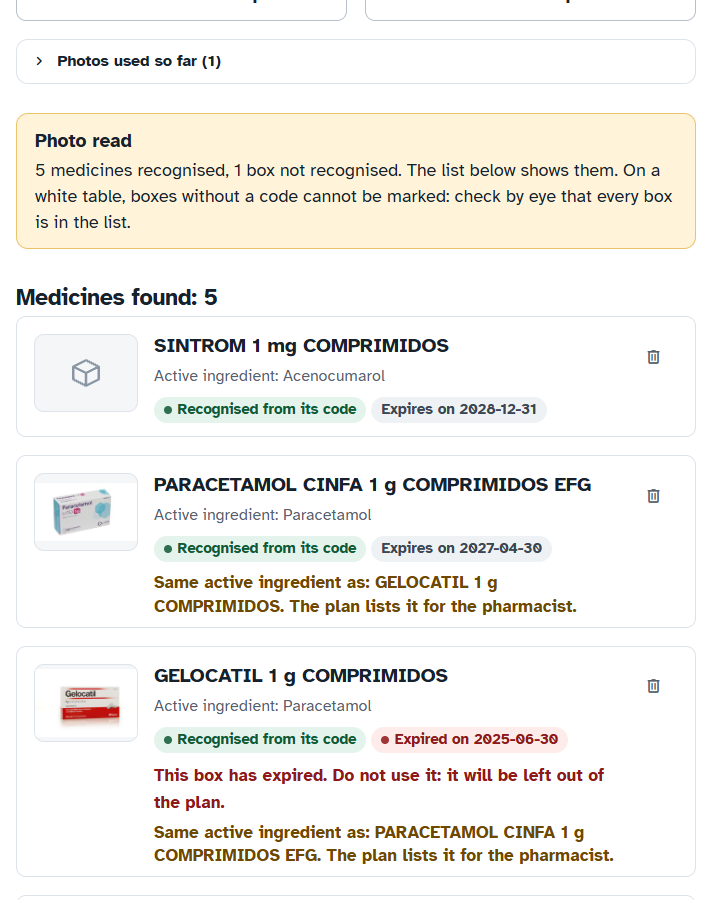
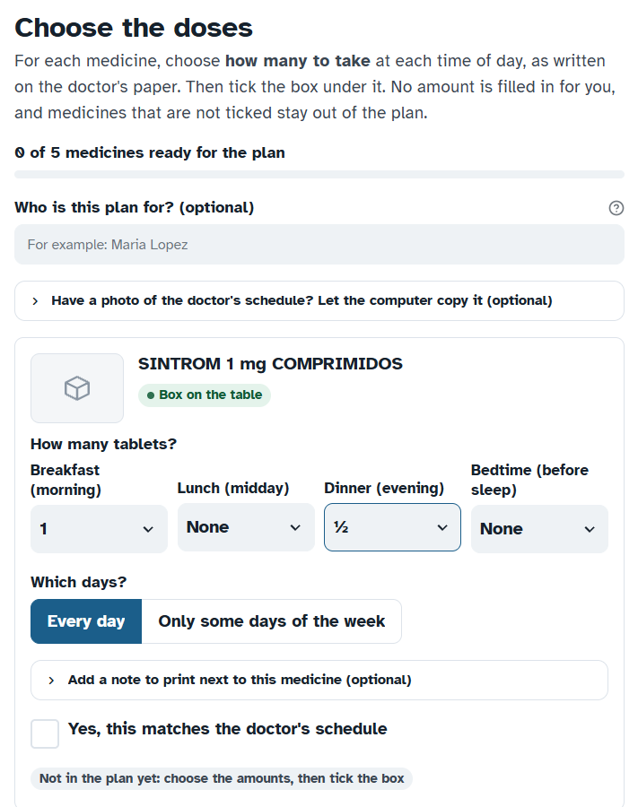
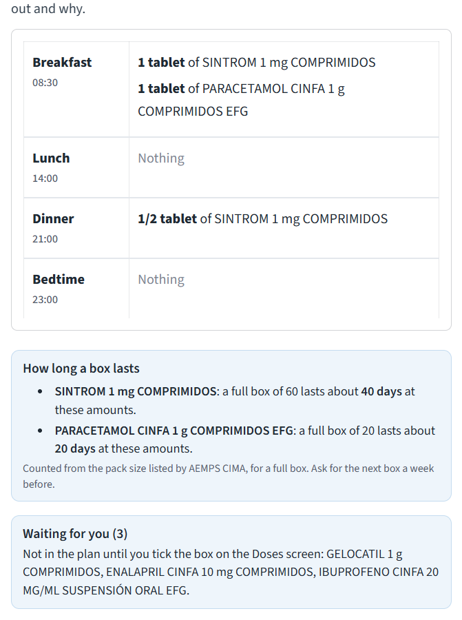
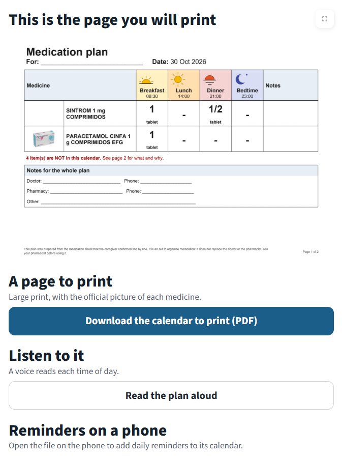
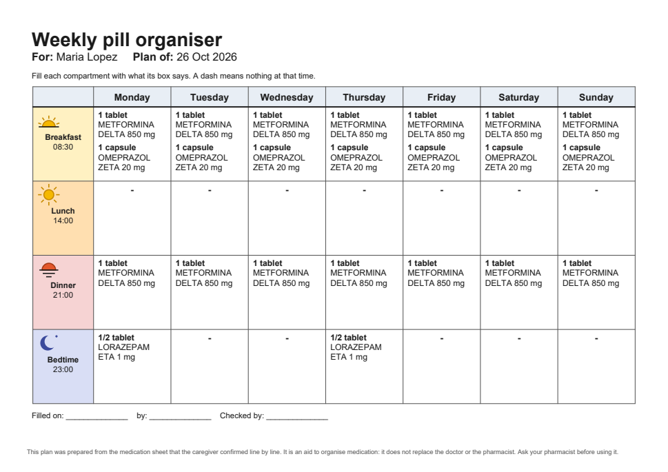
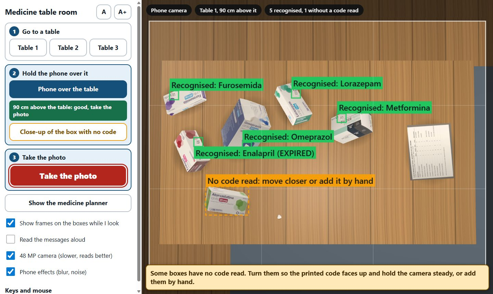

# med-table

[](https://github.com/hsilvosa/med-table-meta-hackathon/actions/workflows/tests.yml)

**Photograph the medicine boxes on the table, get a medication plan you can trust.** med-table helps the family caregiver of an older person who takes many medicines. It identifies every box from the official code printed on it, checks it against Spain's official medicines database (AEMPS CIMA), and turns the doctor's schedule, confirmed by the caregiver, into a large-print calendar for the fridge, a weekly pill organiser guide, a voice that reads the plan aloud and reminders on the phone.

Built during the hackathon with Meta's **Muse Spark** (Meta Model API) and **SAM 3 / 3.1**.

**Try it online, nothing to install: [medtable.hsilvosa.com](https://medtable.hsilvosa.com)** (the 3D room and the planner; the first visit may take a few seconds to start).

> med-table organises what the doctor prescribed. It gives no medical advice, never decides a dose and is not a medical device. Every warning quotes its official source, word for word, for the pharmacist to review.

## The problem

Caregivers of older people on many medicines juggle boxes from different pharmacies, generics with unfamiliar names, half tablets, medicines taken only on some days, and expiry dates printed in small type. Mistakes are easy to make: two boxes with the same active ingredient under different brands, an expired box still in use, a dose copied wrongly from the doctor's paper. med-table makes the box itself the source of truth: its code says what it is, and the official database says what it contains.

## How it works

```
photo of the boxes ─► code on each box ─► AEMPS CIMA ─► doses chosen and confirmed ─► calendar, pill organiser,
                      (Data Matrix, C.N.)  (official     by the caregiver                voice, phone reminders
                                            record)
```

1. **Medicines.** One photo of the whole table. Each box is read from its GS1 Data Matrix code; its national code (Código Nacional) is validated by its check digit and looked up in CIMA, which returns the official name, active ingredients, drug group, pack size and photo. The expiry date comes from the code itself.
2. **Doses.** The caregiver copies the doctor's schedule with large buttons (none, ¼, ½, 1, 1½, 2, 3 or another amount) for breakfast, lunch, dinner and bedtime, every day or on chosen days, and ticks each medicine. Optionally, Muse Spark reads a photo of the schedule and fills in the buttons; the caregiver still checks and ticks every line.
3. **Check.** The plan is shown exactly as it will be printed, with what was left out and why, and the points to ask the pharmacist about.
4. **Print, listen, remind.** A two-page PDF (the calendar for the fridge, and a page for the pharmacist), a one-page weekly pill organiser guide, the plan read aloud for each time of day, and an `.ics` file for phone reminders. The plan can be saved and opened again next month.

### What it checks

- **Same active ingredient in two boxes** (for example two paracetamol brands) and **same drug group** (ATC class).
- **Expired boxes** and boxes **expiring within a month**; with two boxes of one medicine, the plan uses the one that has not expired.
- **The schedule against the boxes**: a medicine on the schedule with no box, a box not on the schedule, a strength that does not match (5 mg on the paper, 10 mg in the box), a line that could match several boxes.
- **What the official leaflets say**: word-for-word quotes from section 4.5 (interactions) when it mentions another medicine on the table, and from section 4.2 about taking it with meals.
- **A second look at unusual amounts**, and **how long a full box lasts** at the chosen doses.
- **What changed since last month**: new medicines, medicines no longer seen, amounts or days that differ.

### Design principles

- **Identification by code, never by a guess.** A box is *verified* only if its code decodes, its national code is valid and CIMA knows it. Models help to locate boxes and to read the schedule; they never identify a medicine or write a dose.
- **The caregiver decides.** Every dose starts at "None"; nothing enters the plan until it is ticked, and changing an amount asks for a new tick.
- **When in doubt, ask.** Anything uncertain is left out of the plan with its reason and a next step ("Go back to Doses and keep one line for this medicine").
- **No verdicts.** The tool never says "safe" or "no interactions"; every warning cites AEMPS and the date of the information.
- **Private by default.** Photos stay on the computer. Only national codes go to the public CIMA API; a picture goes to the Meta Model API only after explicit consent.
- **Written for older users.** One task per screen, large text and buttons, plain words, a "Larger text" setting, and everything in English or Spanish: screens, printed pages, voice and reminders.

## Use cases

- **After a hospital stay**: a daughter organises her father's medicines with one photo and the doses from the discharge sheet, and puts the calendar on the fridge.
- **Filling the weekly pill organiser**: the one-page guide says what goes into each of the 28 compartments, only on the chosen days.
- **The monthly refill**: open last month's plan, photograph the new boxes, see what changed and when each box runs out.
- **A visit to the pharmacist**: page 2 of the PDF lists shared ingredients, leaflet quotes and their sources, ready for a medication review.
- **Low vision or reading difficulties**: the plan read aloud for each time of day.
- **Home care staff** preparing the medication of the people they look after with the same verified steps.

## Try it

**Online**: [medtable.hsilvosa.com](https://medtable.hsilvosa.com). A shared public demo of the 3D room and the planner, with the demo data. Please do not upload photos of real prescriptions or personal data there. The online version runs without the voice, the Muse Spark and SAM 3 features and the camera page; these run in the local installation below. It is served from Google Cloud Run (`Dockerfile`, `scripts/deploy_cloudrun.py`).

**Locally**: Python 3.12. The demo needs no internet connection: the CIMA data of its medicines is in `demo_cache/`.

```bash
python -m venv .venv-app && .venv-app/Scripts/python.exe -m pip install -r requirements.txt

# the planner: http://127.0.0.1:8501  (in Spanish: http://127.0.0.1:8501/?lang=es)
.venv-app/Scripts/python.exe -m streamlit run app.py --server.address 127.0.0.1

# the 3D room with the planner in its side panel: http://127.0.0.1:8600
.venv-app/Scripts/python.exe scripts/start_demo.py

# the camera page, with a webcam (or a phone on the same Wi-Fi: add --lan --https): http://127.0.0.1:8700/camera.html
.venv-app/Scripts/python.exe scripts/start_camera.py
```

In the planner: "Demo photos" > "Load a demo photo" (five real medicines from CIMA, one of them expired, two with the same active ingredient, and one code CIMA does not know). Choose the doses, tick each medicine, check the plan, download the PDF. A guided walkthrough is in [`DEMO.md`](DEMO.md).

| 1. Medicines found in the photo | 2. Doses, chosen with buttons | 3. The plan, checked |
|---|---|---|
|  |  |  |

| 4. The calendar to print | The weekly pill organiser guide | The 3D room: live scan from 90 cm |
|---|---|---|
|  |  |  |

Screenshots of this repository's code running on the demo data. Pack photos and leaflet texts in them are from AEMPS CIMA.

### The 3D room and the camera page

The **3D room** is both a demo and a test bench. Walk around three tables of real CIMA medicines (cut out of their official photos with SAM 3), hold a virtual 12 or 48 MP phone 90 cm above a table, and green boxes appear live on the codes it can read; "Take the photo" sends the picture to the planner. The tables include an expired box, one expiring soon, a code CIMA does not know, boxes without a visible code, loose pills and a fictional medication schedule, and every photo is saved with its ground truth for evaluation. Keys and mouse: WASD to walk, the wheel to zoom, R and F to raise or lower the phone, Tab for the planner.

The **camera page** does the same with a real webcam or phone: live boxes on the codes, one spoken sentence on what to do next ("Move a little closer", "It is too dark"), the camera's zoom and torch when the device has them, and frame averaging in low light. Frames are processed on the local computer.

## Meta models

| Model | What it does | Where it runs |
|---|---|---|
| **Muse Spark** (`muse-spark-1.3`, Meta Model API, standard tier) | Reads a photo of the doctor's schedule into rows that pre-fill the dose buttons; proposes CIMA candidates for a box with no readable code. The caregiver confirms both. | Meta Model API, only after explicit consent, with a hard spending cap enforced in code ([`meta_api.py`](src/medtable/meta_api.py)). Standard tier only, so prompts are not used for training. |
| **SAM 3 / SAM 3.1** | Finds the boxes in a photo that have no readable code, so they can be added; cuts out the CIMA pack photos that build the 3D room. | Locally, on the GPU. |

Model access goes through one module ([`vlm.py`](src/medtable/vlm.py)); a local Qwen3.5-9B backend (`VLM_BACKEND=local`) is available for fully offline use.

## Results

Measured on this repository's evaluation scenes (3D room photos and rendered tables; method and details in [`experiments/README.md`](experiments/README.md)):

- **A whole table in one photo from 90 cm**: about 95 % of the codes read with a 12 MP phone and 98 % with 48 MP, with **0 wrong identifications** in 243 verified boxes.
- **Reading the doctor's schedule** with Muse Spark: **40 of 40 cells** right on a fictional 10-line schedule.
- **Strength check** on 600 randomly drawn CIMA medicines: no false alarm on the official names or the usual ways of writing them, and every changed strength caught.
- **38 automated tests**, one or more per design principle, run on every push; each was checked to fail when the principle it guards is broken.

## Project structure

```
app.py              Streamlit page layout
planner/            the four screens and the session state
src/medtable/       the logic, no UI: codes, CIMA, rules, plan, PDFs, voice, translations
web/                3D room and camera page (three.js); web/world_demo/ is the room shipped in the repository
scripts/            servers, demo launchers, data tools
experiments/        evaluations and their results
demo_cache/         CIMA data of the demo medicines, for offline use (source: AEMPS)
tests/              pytest suite
```

Tests: `.venv-app/Scripts/python.exe -m pip install -r requirements-dev.txt`, then `.venv-app/Scripts/python.exe -m pytest` (about 15 s, no network).

Data tools (optional, to rebuild the full 3D room from all CIMA photos):

```bash
python scripts/download_cima_photos.py manifest   # medicines with photos
python scripts/download_cima_photos.py images     # about 5 GB, resumable
python scripts/make_cutouts.py --n 50             # SAM 3 cut-outs (GPU)
python scripts/build_world.py                     # the room in web/world
```

## Hackathon rules

- **Built during the event**, in this public repository; the full history is in `git log`.
- **Meta models** (Muse Spark, SAM 3 / 3.1) are used where a model adds value; the Meta Model API is used on the standard tier only.
- **Third-party material** is listed in [`THIRD_PARTY.md`](THIRD_PARTY.md). The only third-party data in the repository is the CIMA information of the demo medicines, reused under the AEMPS terms with source and date ([`demo_cache/SOURCE.md`](demo_cache/SOURCE.md), [`web/world_demo/SOURCE.md`](web/world_demo/SOURCE.md)).
- **Not an anti-project**: no medical advice (doses come from the prescription and are confirmed by the caregiver); not a chatbot or a RAG app (no free-text answers, leaflet text is only quoted); not a simple image analyser (identification is by verified code, cross-checked with an official database and the prescription).
- **No real patient data**: every schedule and name in the repository is fictional.

## Next steps

- Validation with photos of real packs and on physical phones, and a pilot with caregivers and community pharmacists.
- The 3D room and the camera page in Spanish, and more languages.
- Checking a filled pill organiser against the plan from a photo.
- Other countries' medicine databases: the GS1 code is international, and the national lookup is a single module.

## License

Apache License 2.0 (see [`LICENSE`](LICENSE)). Copyright 2026 Hugo Silvosa Cuervo. Third-party models and data keep their own terms (see [`THIRD_PARTY.md`](THIRD_PARTY.md)).
